# Awesome Opus 5.6 Videos

[简体中文](README.zh-CN.md)

A credited list of **18 videos** that people shared on X since November 24, 2026, saying they were made by the newer Claude model the community calls "Opus 5.6": animated shorts, 3D scenes, games and a side-by-side test, each written as code that draws every frame.

> **Not announced.** Anthropic has not announced a model called Opus 5.6, and the model picker still says Opus 5.5. Since November 24, 2026, some users report that requests sent to Opus 5.5 are answered by a newer model: it knows about events after Opus 5.5's training cutoff and its work is clearly stronger. This list collects the videos they share, picked by hand (only work clearly beyond what Opus 5.5 usually makes; reposts left out), and will be updated when Anthropic confirms a name and a date.

Watch them all, with filters, at **[claude-motion.com/opus-5-6-videos](https://claude-motion.com/opus-5-6-videos)**

## Motion graphics

<table>
<tr>
<td width="33%" valign="top"><a href="https://x.com/ishuagra02/status/2125345032697999523">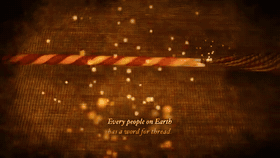</a> <b><a href="https://x.com/ishuagra02/status/2125345032697999523">Human cultures through history, as one moving painted tapestry</a></b> <a href="https://x.com/ishuagra02">@ishuagra02</a> · 2:33 · <a href="https://x.com/ishuagra02/status/2125345032697999523">original post on X</a> ~$112 in API use</td>
</tr>
</table>

## Animated films

<table>
<tr>
<td width="33%" valign="top"><a href="https://x.com/chetaslua/status/2125253343480275008">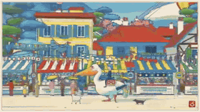</a> <b><a href="https://x.com/chetaslua/status/2125253343480275008">A pelican rides through a festival market and up into a lantern sky</a></b> <a href="https://x.com/chetaslua">@chetaslua</a> · 1:22 · <a href="https://x.com/chetaslua/status/2125253343480275008">original post on X</a> Three.js</td>
<td width="33%" valign="top"><a href="https://x.com/chetaslua/status/2125331978891461023">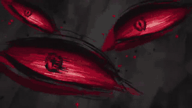</a> <b><a href="https://x.com/chetaslua/status/2125331978891461023">A two-minute anime short, song and all, written in code</a></b> <a href="https://x.com/chetaslua">@chetaslua</a> · 1:54 · <a href="https://x.com/chetaslua/status/2125331978891461023">original post on X</a></td>
<td width="33%" valign="top"><a href="https://x.com/chetaslua/status/2125226204764733481">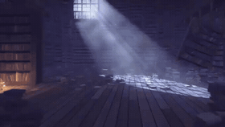</a> <b><a href="https://x.com/chetaslua/status/2125226204764733481">A fox in a library draws a bird that flies off the page</a></b> <a href="https://x.com/chetaslua">@chetaslua</a> · 1:02 · <a href="https://x.com/chetaslua/status/2125226204764733481">original post on X</a></td>
</tr>
<tr>
<td width="33%" valign="top"><a href="https://x.com/LeeLinAI123/status/2125403314221142191">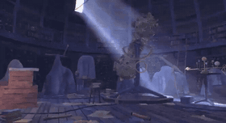</a> <b><a href="https://x.com/LeeLinAI123/status/2125403314221142191">The Last Star: a little robot at an observatory, every frame drawn in Python</a></b> <a href="https://x.com/LeeLinAI123">@LeeLinAI123</a> · 1:00 · <a href="https://x.com/LeeLinAI123/status/2125403314221142191">original post on X</a> Python</td>
<td width="33%" valign="top"><a href="https://x.com/chetaslua/status/2125288009990103316">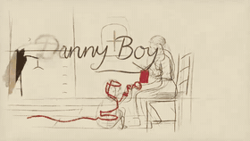</a> <b><a href="https://x.com/chetaslua/status/2125288009990103316">A painted short set to 'Danny Boy', the singing made in code too</a></b> <a href="https://x.com/chetaslua">@chetaslua</a> · 2:32 · <a href="https://x.com/chetaslua/status/2125288009990103316">original post on X</a></td>
<td width="33%" valign="top"><a href="https://x.com/chetaslua/status/2125590864043082001">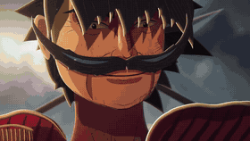</a> <b><a href="https://x.com/chetaslua/status/2125590864043082001">An anime battle short with its own song, all in code</a></b> <a href="https://x.com/chetaslua">@chetaslua</a> · 1:46 · <a href="https://x.com/chetaslua/status/2125590864043082001">original post on X</a></td>
</tr>
<tr>
<td width="33%" valign="top"><a href="https://x.com/anstapnever/status/2125334916305231885">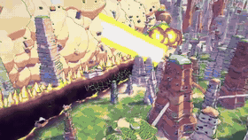</a> <b><a href="https://x.com/anstapnever/status/2125334916305231885">A 78-second anime fight, a capybara against a warlord, built by six agent teams</a></b> <a href="https://x.com/anstapnever">@anstapnever</a> · 1:18 · <a href="https://x.com/anstapnever/status/2125334916305231885">original post on X</a> Three.js</td>
<td width="33%" valign="top"><a href="https://x.com/RezAIT00/status/2125285225769164985">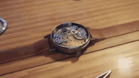</a> <b><a href="https://x.com/RezAIT00/status/2125285225769164985">A watchmaker's town hidden inside a pocket watch</a></b> <a href="https://x.com/RezAIT00">@RezAIT00</a> · 0:20 · <a href="https://x.com/RezAIT00/status/2125285225769164985">original post on X</a> 50 min</td>
<td width="33%" valign="top"><a href="https://x.com/pankajkumar_dev/status/2125578816529805529">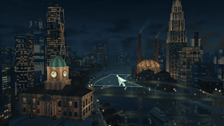</a> <b><a href="https://x.com/pankajkumar_dev/status/2125578816529805529">Editing reality: a city reshaped by a cursor, in seamless shots</a></b> <a href="https://x.com/pankajkumar_dev">@pankajkumar_dev</a> · 1:05 · <a href="https://x.com/pankajkumar_dev/status/2125578816529805529">original post on X</a></td>
</tr>
<tr>
<td width="33%" valign="top"><a href="https://x.com/RezAIT00/status/2125625555328405599">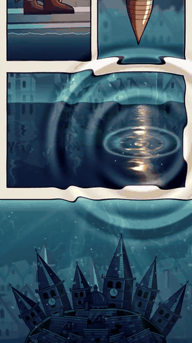</a> <b><a href="https://x.com/RezAIT00/status/2125625555328405599">An animated webtoon: a girl with a lantern faces a city-sized beast</a></b> <a href="https://x.com/RezAIT00">@RezAIT00</a> · 0:22 · <a href="https://x.com/RezAIT00/status/2125625555328405599">original post on X</a></td>
</tr>
</table>

## 3D scenes and games

<table>
<tr>
<td width="33%" valign="top"><a href="https://x.com/notjazii/status/2125235869716287677">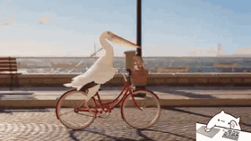</a> <b><a href="https://x.com/notjazii/status/2125235869716287677">A pelican cycling along a seaside promenade, in several shots</a></b> <a href="https://x.com/notjazii">@notjazii</a> · 1:12 · <a href="https://x.com/notjazii/status/2125235869716287677">original post on X</a></td>
<td width="33%" valign="top"><a href="https://x.com/RezAIT00/status/2125368341002924390">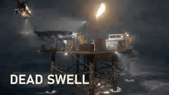</a> <b><a href="https://x.com/RezAIT00/status/2125368341002924390">Dead Swell: a first-person shooter on a stormy sea platform, in three.js</a></b> <a href="https://x.com/RezAIT00">@RezAIT00</a> · 1:11 · <a href="https://x.com/RezAIT00/status/2125368341002924390">original post on X</a> Three.js · 3 hours</td>
<td width="33%" valign="top"><a href="https://x.com/Mr_Salio/status/2125222399809409109">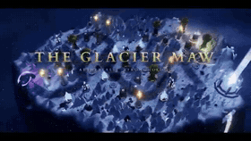</a> <b><a href="https://x.com/Mr_Salio/status/2125222399809409109">The Glacier Maw: the trailer of a tower defense game built from a 20-word prompt</a></b> <a href="https://x.com/Mr_Salio">@Mr_Salio</a> · 0:28 · <a href="https://x.com/Mr_Salio/status/2125222399809409109">original post on X</a></td>
</tr>
<tr>
<td width="33%" valign="top"><a href="https://x.com/RezAIT00/status/2125584762710466881">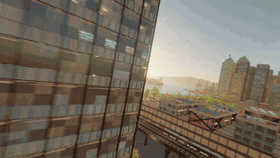</a> <b><a href="https://x.com/RezAIT00/status/2125584762710466881">A giant creature storms a living city, water and all, in one shot</a></b> <a href="https://x.com/RezAIT00">@RezAIT00</a> · 1:06 · <a href="https://x.com/RezAIT00/status/2125584762710466881">original post on X</a></td>
<td width="33%" valign="top"> <b><a href="https://x.com/lemomo_ai/status/2125250592243155013">A brass calligraphy machine writing Chinese characters, in one shot</a></b> <a href="https://x.com/lemomo_ai">@lemomo_ai</a> · 0:54 · <a href="https://x.com/lemomo_ai/status/2125250592243155013">original post on X</a></td>
</tr>
</table>

## Music

<table>
<tr>
<td width="33%" valign="top"><a href="https://x.com/notjazii/status/2125517704031621562">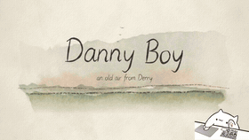</a> <b><a href="https://x.com/notjazii/status/2125517704031621562">A watercolor music film of 'Danny Boy', song and picture in code</a></b> <a href="https://x.com/notjazii">@notjazii</a> · 2:40 · <a href="https://x.com/notjazii/status/2125517704031621562">original post on X</a></td>
</tr>
</table>

## Model comparisons

<table>
<tr>
<td width="33%" valign="top"><a href="https://x.com/RezAIT00/status/2125430728305369324">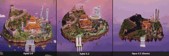</a> <b><a href="https://x.com/RezAIT00/status/2125430728305369324">A floating island of China, one shot: the newer model vs Fable 5.2 vs Opus 5.5</a></b> <a href="https://x.com/RezAIT00">@RezAIT00</a> · 0:12 · <a href="https://x.com/RezAIT00/status/2125430728305369324">original post on X</a> Devin</td>
</tr>
</table>

## Make your own

- [Claude Fable 5.2 videos](https://claude-motion.com/fable-5-2-videos), [GPT-6.2 videos](https://claude-motion.com/gpt-6-2-videos) and [Gemini 4 videos](https://claude-motion.com/gemini-4-videos): the same kind of list for released models ([Fable](https://github.com/hideewsj-maker/awesome-fable-5-2-videos), [GPT-6.2](https://github.com/hideewsj-maker/awesome-gpt-6-2-videos) and [Gemini 4](https://github.com/hideewsj-maker/awesome-gemini-4-videos) on GitHub).
- [HTML to video](https://claude-motion.com/html-to-video): paste the HTML the model wrote and save it as MP4, GIF or WebM, free, in your browser.
- [Motion Director](https://github.com/hideewsj-maker/motion-skills): a free skill for Claude Code, Codex and Cursor that makes a whole film with music.

## Add a video

Open an issue or a pull request with the link to the post on X. The post should say the newer model ("Opus 5.6") made it, be from November 24, 2026 or later, and the work should be clearly beyond ordinary Opus 5.5 output. Entries are checked by hand.

## Credit and removal

Every video belongs to the person who made it; each entry names its maker and links to the original post. Titles are descriptions of what the post says. If an entry is yours and you want it removed, open an issue or write to the takedown address on claude-motion.com and it comes down.

The list itself (titles, categories, this text) is CC BY 4.0. The videos and prompts are their makers'.
