# Opus 5.6 视频作品合集

[English](README.md)

收录 **18 条视频**，都是 2026 年 11 月 24 日以来创作者在 X 上分享、称由社区所说的“Opus 5.6”（Claude 的新模型）做出的：动画短片、3D 场景、游戏和一条同题对比。每一帧都由模型写的代码画出来。

> **尚未发布。** Anthropic 还没有公布名为 Opus 5.6 的模型，模型选择器里显示的仍是 Opus 5.5。2026 年 11 月 24 日起，有用户反映发给 Opus 5.5 的请求由一个更新的模型作答：它知道 Opus 5.5 训练截止之后的事，作品也明显更强。本列表收集他们分享的视频，人工挑选（只收明显超出 Opus 5.5 一般水平的作品，不收转发），Anthropic 确认名称和日期后会更新。

带分类筛选的完整合集： **[claude-motion.com/opus-5-6-videos](https://claude-motion.com/zh/opus-5-6-videos)**

## 动态图形

<table>
<tr>
<td width="33%" valign="top"><a href="https://x.com/ishuagra02/status/2125345032697999523">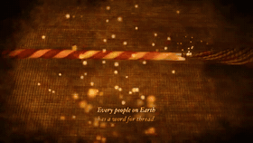</a> <b><a href="https://x.com/ishuagra02/status/2125345032697999523">人类各时代的文化，化作一幅流动的手绘长卷</a></b> <a href="https://x.com/ishuagra02">@ishuagra02</a> · 2:33 · <a href="https://x.com/ishuagra02/status/2125345032697999523">X 原帖</a> ~$112 in API use</td>
</tr>
</table>

## 动画短片

<table>
<tr>
<td width="33%" valign="top"><a href="https://x.com/chetaslua/status/2125253343480275008">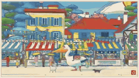</a> <b><a href="https://x.com/chetaslua/status/2125253343480275008">鹈鹕穿过热闹的集市，一路飞进满天孔明灯</a></b> <a href="https://x.com/chetaslua">@chetaslua</a> · 1:22 · <a href="https://x.com/chetaslua/status/2125253343480275008">X 原帖</a> Three.js</td>
<td width="33%" valign="top"><a href="https://x.com/chetaslua/status/2125331978891461023">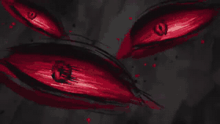</a> <b><a href="https://x.com/chetaslua/status/2125331978891461023">两分钟的动画短片，连主题曲都是代码写的</a></b> <a href="https://x.com/chetaslua">@chetaslua</a> · 1:54 · <a href="https://x.com/chetaslua/status/2125331978891461023">X 原帖</a></td>
<td width="33%" valign="top"><a href="https://x.com/chetaslua/status/2125226204764733481">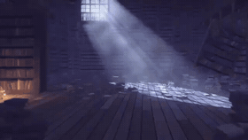</a> <b><a href="https://x.com/chetaslua/status/2125226204764733481">图书馆里的狐狸画出一只鸟，鸟从纸上飞了出去</a></b> <a href="https://x.com/chetaslua">@chetaslua</a> · 1:02 · <a href="https://x.com/chetaslua/status/2125226204764733481">X 原帖</a></td>
</tr>
<tr>
<td width="33%" valign="top"><a href="https://x.com/LeeLinAI123/status/2125403314221142191">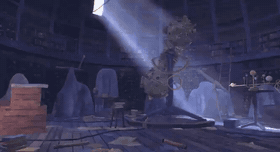</a> <b><a href="https://x.com/LeeLinAI123/status/2125403314221142191">《The Last Star》：天文台的小机器人，每一帧都用 Python 画出</a></b> <a href="https://x.com/LeeLinAI123">@LeeLinAI123</a> · 1:00 · <a href="https://x.com/LeeLinAI123/status/2125403314221142191">X 原帖</a> Python</td>
<td width="33%" valign="top"><a href="https://x.com/chetaslua/status/2125288009990103316">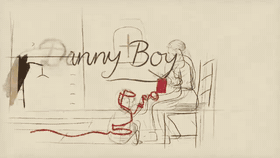</a> <b><a href="https://x.com/chetaslua/status/2125288009990103316">配《Danny Boy》的手绘风短片，连歌声也是代码生成的</a></b> <a href="https://x.com/chetaslua">@chetaslua</a> · 2:32 · <a href="https://x.com/chetaslua/status/2125288009990103316">X 原帖</a></td>
<td width="33%" valign="top"> <b><a href="https://x.com/chetaslua/status/2125590864043082001">自带主题曲的动漫战斗短片，全部用代码写成</a></b> <a href="https://x.com/chetaslua">@chetaslua</a> · 1:46 · <a href="https://x.com/chetaslua/status/2125590864043082001">X 原帖</a></td>
</tr>
<tr>
<td width="33%" valign="top"><a href="https://x.com/anstapnever/status/2125334916305231885">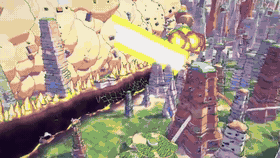</a> <b><a href="https://x.com/anstapnever/status/2125334916305231885">78 秒动画打斗：水豚对战军阀，六组智能体并行完成</a></b> <a href="https://x.com/anstapnever">@anstapnever</a> · 1:18 · <a href="https://x.com/anstapnever/status/2125334916305231885">X 原帖</a> Three.js</td>
<td width="33%" valign="top"><a href="https://x.com/RezAIT00/status/2125285225769164985">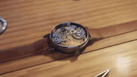</a> <b><a href="https://x.com/RezAIT00/status/2125285225769164985">藏在怀表里的钟表匠小镇</a></b> <a href="https://x.com/RezAIT00">@RezAIT00</a> · 0:20 · <a href="https://x.com/RezAIT00/status/2125285225769164985">X 原帖</a> 50 min</td>
<td width="33%" valign="top"> <b><a href="https://x.com/pankajkumar_dev/status/2125578816529805529">编辑现实：一只光标改写整座城市，镜头无缝衔接</a></b> <a href="https://x.com/pankajkumar_dev">@pankajkumar_dev</a> · 1:05 · <a href="https://x.com/pankajkumar_dev/status/2125578816529805529">X 原帖</a></td>
</tr>
<tr>
<td width="33%" valign="top"><a href="https://x.com/RezAIT00/status/2125625555328405599">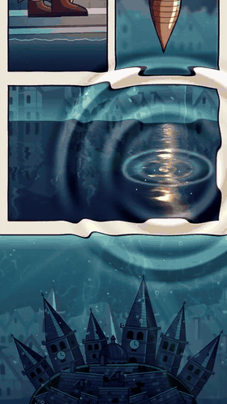</a> <b><a href="https://x.com/RezAIT00/status/2125625555328405599">会动的条漫：提灯女孩直面城市般巨大的怪兽</a></b> <a href="https://x.com/RezAIT00">@RezAIT00</a> · 0:22 · <a href="https://x.com/RezAIT00/status/2125625555328405599">X 原帖</a></td>
</tr>
</table>

## 3D 场景与游戏

<table>
<tr>
<td width="33%" valign="top"> <b><a href="https://x.com/notjazii/status/2125235869716287677">鹈鹕沿着海滨步道骑车，多个镜头切换</a></b> <a href="https://x.com/notjazii">@notjazii</a> · 1:12 · <a href="https://x.com/notjazii/status/2125235869716287677">X 原帖</a></td>
<td width="33%" valign="top"><a href="https://x.com/RezAIT00/status/2125368341002924390">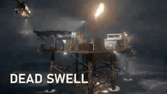</a> <b><a href="https://x.com/RezAIT00/status/2125368341002924390">Dead Swell：暴风雨海上平台的第一人称射击游戏，three.js 实现</a></b> <a href="https://x.com/RezAIT00">@RezAIT00</a> · 1:11 · <a href="https://x.com/RezAIT00/status/2125368341002924390">X 原帖</a> Three.js · 3 hours</td>
<td width="33%" valign="top"><a href="https://x.com/Mr_Salio/status/2125222399809409109">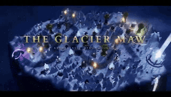</a> <b><a href="https://x.com/Mr_Salio/status/2125222399809409109">《The Glacier Maw》：用 20 个词的提示词做出的塔防游戏及其预告片</a></b> <a href="https://x.com/Mr_Salio">@Mr_Salio</a> · 0:28 · <a href="https://x.com/Mr_Salio/status/2125222399809409109">X 原帖</a></td>
</tr>
<tr>
<td width="33%" valign="top"><a href="https://x.com/RezAIT00/status/2125584762710466881">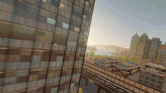</a> <b><a href="https://x.com/RezAIT00/status/2125584762710466881">一次生成：巨兽冲进热闹的城市，连水花都在动</a></b> <a href="https://x.com/RezAIT00">@RezAIT00</a> · 1:06 · <a href="https://x.com/RezAIT00/status/2125584762710466881">X 原帖</a></td>
<td width="33%" valign="top"><a href="https://x.com/lemomo_ai/status/2125250592243155013">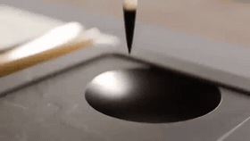</a> <b><a href="https://x.com/lemomo_ai/status/2125250592243155013">一次生成：黄铜书法机器一笔一画写出汉字</a></b> <a href="https://x.com/lemomo_ai">@lemomo_ai</a> · 0:54 · <a href="https://x.com/lemomo_ai/status/2125250592243155013">X 原帖</a></td>
</tr>
</table>

## 音乐

<table>
<tr>
<td width="33%" valign="top"><a href="https://x.com/notjazii/status/2125517704031621562">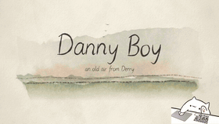</a> <b><a href="https://x.com/notjazii/status/2125517704031621562">水彩风《Danny Boy》音乐短片，歌和画面都是代码</a></b> <a href="https://x.com/notjazii">@notjazii</a> · 2:40 · <a href="https://x.com/notjazii/status/2125517704031621562">X 原帖</a></td>
</tr>
</table>

## 模型对比

<table>
<tr>
<td width="33%" valign="top"><a href="https://x.com/RezAIT00/status/2125430728305369324">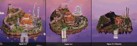</a> <b><a href="https://x.com/RezAIT00/status/2125430728305369324">一次生成的中国浮岛：新模型 vs Fable 5.2 vs Opus 5.5</a></b> <a href="https://x.com/RezAIT00">@RezAIT00</a> · 0:12 · <a href="https://x.com/RezAIT00/status/2125430728305369324">X 原帖</a> Devin</td>
</tr>
</table>

## 自己做一支

- [Claude Fable 5.2 视频合集](https://claude-motion.com/zh/fable-5-2-videos)、[GPT-6.2 视频合集](https://claude-motion.com/zh/gpt-6-2-videos)和 [Gemini 4 视频合集](https://claude-motion.com/zh/gemini-4-videos)：已发布模型的同类合集（GitHub：[Fable](https://github.com/hideewsj-maker/awesome-fable-5-2-videos)、[GPT-6.2](https://github.com/hideewsj-maker/awesome-gpt-6-2-videos)、[Gemini 4](https://github.com/hideewsj-maker/awesome-gemini-4-videos)）。
- [HTML 转视频](https://claude-motion.com/zh/html-to-video)：粘贴模型写的 HTML，在浏览器里免费导出 MP4、GIF 或 WebM。
- [Motion Director](https://github.com/hideewsj-maker/motion-skills)：免费 Skill，在 Claude Code、Codex、Cursor 里做出带配乐的整支片子。

## 提交作品

提 issue 或 pull request，附上 X 原帖链接。原帖需要写明由新模型（“Opus 5.6”）做出、发布于 2026 年 11 月 24 日或之后，且作品明显超出 Opus 5.5 的一般水平。收录前会人工核对。

## 署名与下架

视频归创作者所有；每条都注明作者并链接到原帖。标题是对原帖内容的描述。如果其中有作品需要下架，请提 issue，或写信到 claude-motion.com 页脚的下架邮箱，会及时移除。

列表本身（标题、分类和本文）采用 CC BY 4.0。视频和提示词归各自作者所有。
